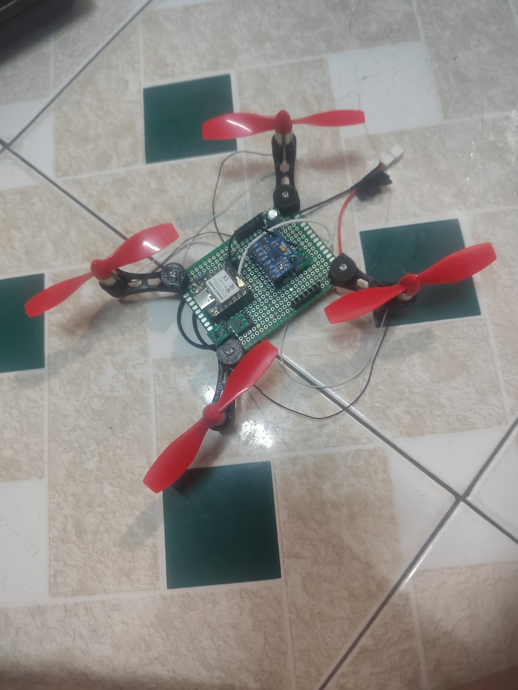
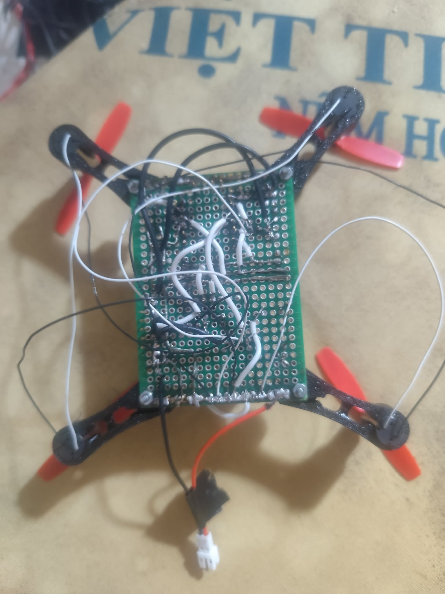

# DIY mini drone – XIAO ESP32-S3

A personal project: a small quadcopter built from scratch, with my own flight firmware and an Android app as the remote control.





https://github.com/user-attachments/assets/704e980e-f666-42e4-bf41-4761753f6d29


## How it works
| Part | Role |
|---|---|
| **Seeed XIAO ESP32-S3** | Main controller: runs the flight firmware (500 Hz loop) and creates its own WiFi network |
| **MPU6500 (GY-521 module)** | Motion sensor for balance: measures tilt and rotation speed |
| **4 × N-channel MOSFET** | Switch the 4 motors on/off with PWM (20 kHz) to control their speed |
| **4 × 8520 coreless motor** | Brushed motors, 2 clockwise + 2 counter-clockwise |
| **1S LiPo 3.7 V** | Battery |
| **Android app** (Kotlin + Jetpack Compose) | Remote control: joysticks or phone gestures, sends commands to the XIAO over **UDP** |

```
Android app ──UDP 50×/s (commands)──▶ XIAO ESP32-S3 ──PWM──▶ MOSFET ──▶ motor (×4)
            ◀─UDP 10×/s (telemetry)──      ▲
                                           │ I2C
                                        MPU6500
```

The XIAO reads the MPU, combines the gyro and accelerometer (complementary filter), runs a 2-stage PID
(angle → rotation speed) and mixes the result into 4 motor powers.

## Folders
| Folder | Content |
|---|---|
| `drone_fc2/` | Flight firmware (Arduino, header-only C++). Details: `drone_fc2/README.md` |
| `android control app/` | Android app (open this folder in Android Studio) |
| `img/` | Photos |

## Quick start
1. **Firmware:** open `drone_fc2/drone_fc2.ino` in Arduino IDE, board **XIAO_ESP32S3**, **USB CDC On Boot: Enabled**, ESP32 core 3.x → Upload.
2. **App:** open `android control app/` in Android Studio → Run on the phone.
3. Power the drone, open the app, connect to WiFi **XIAO-Drone** when asked.

## Status
Work in progress: firmware and app are working; currently fixing the motor power wiring (voltage drop / resets)
before the first flight.
